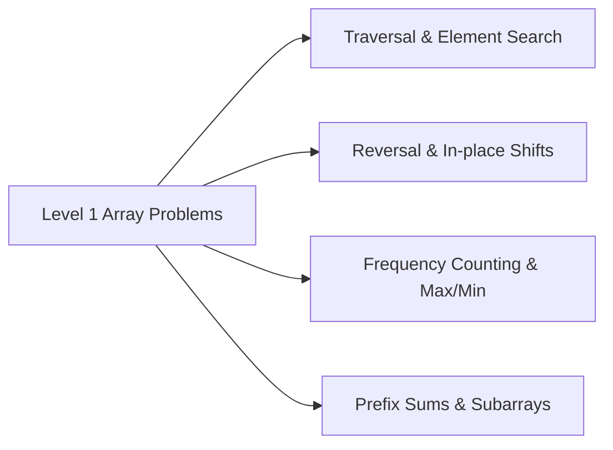

# 📊 Array Practice Problem Set — Course 23201009

  <b>A comprehensive collection of 11 core array manipulation and algorithmic problem solutions in C++.</b>

---

## 📌 Problem Directory

| Problem File | Core Focus & Technique |
| :--- | :--- |
| `level1Problem1.cpp` | Array initialization, input validation, and forward/backward traversal |
| `level1Problem2.cpp` | Finding maximum and minimum elements with linear scan |
| `level1Problem3.cpp` | Sum and average calculation across dynamic array bounds |
| `level1Problem4.cpp` | Element frequency counting and occurrence tally |
| `level1Problem5.cpp` | Searching algorithms (Linear search / sentinel search) |
| `level1Problem6.cpp` | In-place array reversal with two-pointer technique |
| `level1Problem7.cpp` | Array element swapping and rotational shifting |
| `level1Problem8.cpp` | Filtering even/odd indices and conditional partitioning |
| `level1Problem9.cpp` | Merging two sorted/unsorted linear sequences |
| `level1Problem10.cpp` | Duplicate element detection and unique filtering |
| `level1Problem11.cpp` | Subarray extraction and boundary constraint verification |

---

## 👨‍💻 Author

**Momin Rifat**  
Student ID: 23201009  
GitHub: [@MominRifat](https://github.com/MominRifat)
